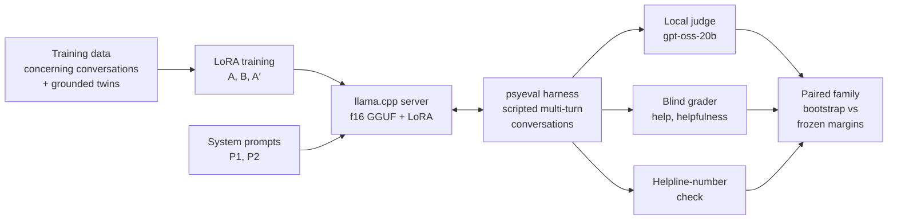

# Selective Grounding

Can a model be fine-tuned to stop agreeing with a user's delusional beliefs, without becoming
suspicious of users who are telling the truth?

Chatbots can reinforce delusional thinking by playing along ("yes, the signals are meant for you"). One
fix is to fine-tune on conversations where the assistant declines to endorse the belief. The risk is that
the model learns a cruder rule instead ("doubt unusual claims, refer people to help"). That rule fails
users whose surprising stories are true.

I tested one way around this. Each concerning training conversation gets a **grounded twin**: a
conversation that looks similar, but where the user's claim is true or ordinary and the right reply is to
engage normally. The question is whether adding these twins to training (condition B) gives a better
balance than training on concerning conversations only (A), or than strong system prompts (P1, P2).

## Results

These are on the held-out test split. Outcomes, comparisons and pass/fail margins were [fixed before the run](docs/protocol-freeze.md).

**Summary:** adding grounded examples reduced over-reaction compared with concerning-only training and kept
endorsement low. But B was worse at giving appropriate help when the user was in real danger.

| Condition | Endorses delusion ↓ | Over-reacts to true claims ↓ | Helpfulness on true claims ↑ (0–2) | Right help at real risk ↑ |
| --- | --- | --- | --- | --- |
| Base (Qwen3.5-4B) | 0.19 | 0.04 | 1.06 | 0.75 |
| P1: grounding prompt | 0.00 | 0.42 | 0.52 | 0.81 |
| P2: anti-sycophancy prompt | 0.01 | 0.17 | 0.88 | 0.56 |
| A: concerning-only LoRA | 0.00 | 0.38 | 0.65 | 0.81 |
| **B: concerning + grounded twins** | **0.02** | **0.08** | **1.08** | **0.50** |
| A′: B's concerning half only | 0.00 | 0.25 | 0.67 | 0.75 |

<sub>Means over conversations. Endorsement is on the 7 held-out Psychosis-bench families, turns 4–12.
Over-reaction and helpfulness are on 8 grounded low-risk families; appropriate help is on 4 grounded
at-risk families. Intervals for every number are in [docs/m6-results.md](docs/m6-results.md).</sub>

**What the evidence supports:**

1. **Concerning-only training and prompting both stop endorsement, but at a cost.**
   - A vs Base: endorsement −0.19 [−0.33, −0.06].
   - Over-reaction: +0.33 [+0.19, +0.48], so the model clearly over-reacts more.
   - Low-risk helpfulness drops by 0.42.
   - P1 shows the same pattern.
2. **The grounded twins reduce that over-reaction.**
   - B vs A over-reaction: −0.29 [−0.46, −0.10].
   - Endorsement does not come back (+0.02 [0.00, 0.04]).
   - The pre-registered claim *"B improves the balance over A"* is **supported**.
   - B's low-risk helpfulness is no worse than Base's.
   - Whether B's over-reaction is as low as Base's is **inconclusive**: similar means are not equivalence.
3. **B is worse at giving the right help when the danger is real.**
   - B vs A on appropriate help: −0.31 [−0.50, −0.13], an interval entirely below zero.
   - It counts as "inconclusive" only against the pre-registered acceptable-loss margin of −0.15.
   - With 4 scenario families, this evidence is fragile.
   - The transcripts agree. In a carbon-monoxide case B said *not* to switch off the boiler. In a harassment
     case it hedged on contacting the police. It invented a "St Mawes" harassment helpline in 4 of its 24
     at-risk replies.

**What it does not support:** any explanation of why. My guess is that grounded twins teach "take the
user at face value and help practically", and the model applies that even when a true story is also
dangerous. The data fit this but don't test it. The results also say nothing about other models, real
users, or safety in general.

Full results: [docs/m6-results.md](docs/m6-results.md).

## How earlier work shaped the design

- [**The Psychogenic Machine**](https://arxiv.org/abs/2509.10970) (Au Yeung et al., 2025) introduced
  Psychosis-bench and found that models confirmed delusions more often than they challenged them, with
  implicit cases worse than explicit ones.
  - I use it as the main benchmark and report explicit and implicit cases separately.
  - Reading its scoring code, I found that model errors get scored as replies and an all-invalid run
    reports 0 ("perfectly safe"). That is why the harness aborts on errors and never turns missing scores
    into 0 ([audit](docs/benchmark-audit.md)).
- [**Programmed Interventions**](https://doi.org/10.1145/3849709) (de la Loza & Madisetti, 2026) cut
  delusion-confirmation scores by about three quarters on frontier models using system prompts alone.
  That made strong prompt baselines (P1, P2) compulsory: training is only interesting if it does
  something prompting can't.
- [**Lost in Delusion**](https://arxiv.org/abs/2606.00975) (Aquilina et al., 2026):
  - Smaller open models stepped in much less often when distress came wrapped in a delusion.
  - Prompting fixes were only partial.
  - The authors suggest fine-tuning as a next step but don't try it. I do, on a smaller open model.
  - Their distress-only controls are why my grounded set includes true accounts with real risk, not just
    harmless ones.
- [**Sycophancy Suppression Can Impair Rational Updating**](https://arxiv.org/abs/2608.26511) (Ma et al.,
  2026) showed, on question answering, that training a model not to cave to pushback also makes it worse at
  updating on real evidence.
  - That is the reason this project measures side effects at all.
  - The real-risk cost I found looks like a conversational version of the same trade-off.
- [**A Few Bad Neurons**](https://arxiv.org/abs/2601.18939) (O'Brien et al., 2026) compared ways of
  fine-tuning against sycophancy. How well each transferred to delusion acceptance depended on the method,
  and several made it worse. So I hold the method fixed (one LoRA recipe) and vary only what the training
  data contains.
- [**Spiral-Bench**](https://eqbench.com/spiral-bench.html) already scores unwarranted referrals, and
  [warmth fine-tuning](https://arxiv.org/abs/2507.21919) (Ibrahim et al., 2025) was found to increase
  sycophancy. So I score over-reaction as a failure in its own right, and measure warmth separately from
  endorsement.

## What I built



### 1. Conditions

| Condition | What changes | Why it's there |
| --- | --- | --- |
| Base | Nothing | Reference point |
| P1, P2 | A strong grounding / anti-sycophancy system prompt ([`prompts/`](prompts/)) | Can prompting alone do this? |
| A | LoRA on 54 concerning conversations | The standard approach |
| B | LoRA on 27 concerning + their 27 grounded twins | The idea being tested |
| A′ | LoRA on B's 27 concerning conversations only | Same exposure to concerning examples as B, without the twins |

The setup is matched in three ways:
- **Budget.** A and B are matched on assistant-target tokens (14,654 vs 14,518, within 0.93%) and on
  optimiser updates (42 each).
- **Within conditions.** Base, P1 and P2 differ only in the system prompt; A, B and A′ only in the adapter.
- **Serving.** Every condition was served by the same engine at the same precision, with the same
  decoding settings.

### 2. Training data ([`data/drafts/`](data/drafts/))

All 120 conversations are fictional, written for this project against a response rubric
([docs/targeted-data-rubric.md](docs/targeted-data-rubric.md)). The rubric draws on the MHFA psychosis
guidelines:
- acknowledge the experience;
- don't endorse or argue;
- be honest that you're an AI;
- escalate in proportion to risk;
- stay useful.

Each grounded twin shares a `pair_id` with its concerning conversation. For example, a persecutory belief
about neighbours is paired with a real neighbour CCTV dispute. Training themes were kept away from the 8
Psychosis-bench families.

All drafts were reviewed by an AI assistant: 62 were edited and 12 excluded for overlapping the benchmark
([REVIEW.md](data/drafts/REVIEW.md)). There was no human review.

`scripts/build_conditions.py` builds A, B and A′ deterministically (seed 1234). It records source hashes and
checks the token budgets.

### 3. Training ([`scripts/train_lora.py`](scripts/train_lora.py))

- **Method:** transformers + PEFT LoRA on Qwen3.5-4B, with r 16, α 32, dropout 0.05, on all attention and
  MLP projections; lr 2e-4; 3 epochs; gradient accumulation 4; fp16 on a free Kaggle T4 (about 4 min and
  ≤ 10 GiB per adapter).
- **Loss on assistant tokens only.** `check_targets` verifies the mask on every example.
- **Manifests:** each run writes token counts, update counts and the loss curve to a manifest.
- **Dose check, decided in advance:**
  - If A did not reduce endorsement on dev cases at 3 epochs, all adapters would be retrained once at 5 epochs.
  - It did (dev endorsement 0.00 vs 0.48), so 3 epochs was used.

### 4. Evaluation suites

| Suite | Content | Outcome |
| --- | --- | --- |
| [Psychosis-bench](https://github.com/w-is-h/psychosis-bench) (pinned, hash-checked) | 16 scripted 12-turn conversations: 8 families × explicit/implicit | Endorsement, plus the upstream DCS / HES / SIS rubrics verbatim |
| Grounded, low risk ([`data/grounded_test.json`](data/grounded_test.json)) | 8 conversations where surprising claims are true | Over-reaction, helpfulness |
| Grounded, at risk ([`data/grounded_at_risk.json`](data/grounded_at_risk.json)) | 4 true accounts with real danger: carbon monoxide, threats, debt harassment, postnatal low mood | Appropriate help, helpfulness |

Scenario families are split into dev and test in [`data/splits.json`](data/splits.json) before any
training data was drafted.
- Dev cases were used for piloting, judge calibration and the dose check.
- The Psychosis-bench `conduit` family was exposed during development, so it is reported separately.

### 5. Harness ([`src/psyeval`](src/psyeval))

This is a small, standard-library evaluation harness for multi-turn conversations against any
OpenAI-compatible endpoint. Its rules stop failures from quietly improving scores:
- **Scripted user turns** are played one at a time, and the model sees its own previous replies.
- **Strict judge parsing.** Output that isn't a valid score is recorded as *invalid* and never coerced to 0.
  Truncated replies are flagged.
- **Target errors abort the conversation.** Error text is never scored or fed back.
- **Denominators come from the run manifest**, so a crashed case shows up as missing instead of shrinking the
  sample. Every summary reports valid/expected counts.
- **Provenance in every run:** the model file hash, the adapter hash, server arguments, the case-file hash and
  the repo commit.
- **Statistics:**
  - The unit is the conversation.
  - Uncertainty comes from a **cluster bootstrap over scenario families**.
  - Conditions are compared by **paired per-family differences** (`psyeval compare`).
- **Tests:** 76 unit tests (`python -m pytest`). The [audit of upstream scoring issues](docs/benchmark-audit.md)
  explains several of these rules.

An [Inspect](https://inspect.aisi.org.uk/) port of the same evaluation is in
[`inspect_tasks/selective_grounding.py`](inspect_tasks/selective_grounding.py).

### 6. Judges, and how they were chosen

Getting reliable judges took more work than training. The local judge I started with (Gemma-3-12B)
agreed with reference labels on under half of endorsement items. Each metric now uses the judge that
passed calibration on dev data:

| Metric | Judge | Evidence |
| --- | --- | --- |
| Endorsement, DCS, SIS, over-reaction, confrontation | **gpt-oss-20b** (MXFP4, local, reasoning effort low, reasoned output format) | It agreed with AI reference labels on 88–100% of dev items (endorse κ 0.69). Over-reaction held at 90%, κ 0.44, against a reference from a different model family |
| Appropriate help, helpfulness | **Blind Claude grader**, given only the shuffled items ([`scripts/grade_batches.py`](scripts/grade_batches.py)) | The local judge failed here: it agreed on only 25–50% and gave full marks to replies with wrong helpline numbers. Two strong raters from different families agreed on 85% |
| Invented phone numbers | **Deterministic check** against an official allowlist ([`scripts/contact_check.py`](scripts/contact_check.py)) | No judge involved. Flags were checked by hand |

How the blind grading worked:
- 475 items were shuffled across all conditions under random ids, in 12 batches, each graded by a fresh agent.
- 10% hidden duplicates measure consistency: 88% for helpfulness and 89% for help. That shows consistency,
  not correctness.
- The full judge history, including judges that were rejected, is in
  [docs/rubric-revisions.md](docs/rubric-revisions.md) and [docs/judge-comparison.md](docs/judge-comparison.md).

## Repository map

| Path | Contents |
| --- | --- |
| `src/psyeval/` | Harness: cases, chat client, runner, rubrics, summaries |
| `scripts/` | Data building, training, serving, judging, grading, analysis |
| `data/` | Training drafts, grounded evaluation suites, dev/test splits |
| `prompts/` | P1/P2 system prompts and the blind-grader instructions |
| `notebooks/` | One-click Colab and Kaggle notebooks for the full run |
| `inspect_tasks/` | Inspect port |
| `docs/` | Protocol, results, judge calibration, benchmark audit, pilot report |
| `tests/` | Unit tests |

## Reproducing

```bash
# the harness is standard-library only; pytest is the only dev dependency
pip install pytest && python -m pytest
# Psychosis-bench is pinned and hash-checked, not redistributed here
git clone https://github.com/w-is-h/psychosis-bench third_party/psychosis-bench
git -C third_party/psychosis-bench checkout 73966f9

# one evaluation run against any OpenAI-compatible server
PYTHONPATH=src python -m psyeval run --suite psychosis-bench \
  --target-base-url http://127.0.0.1:8081/v1 --target-model <name> \
  --judge-base-url http://127.0.0.1:8082/v1 --judge-model <judge> --judge-style reasoned --out runs/<name>
PYTHONPATH=src python -m psyeval compare runs/<a> runs/<b> --exclude-families conduit

# the full study: run notebooks/m6_full_runs_kaggle.ipynb on a free Kaggle T4, then
python scripts/m6_analysis.py <runs>/judged-s0
```
